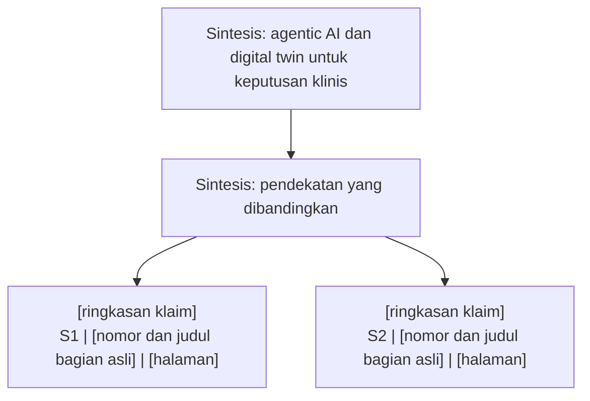

# Contoh interaksi literature-review

Contoh ini menunjukkan bentuk interaksi. Judul bagian dalam tanda kurung siku adalah slot yang harus diisi setelah karya lengkap dibaca. Tidak ada hasil ilmiah atau sitasi paper yang diasumsikan.

## Input pengguna

> Tinjau hubungan agentic AI dan digital twin untuk mendukung pengambilan keputusan klinis. Literatur awal saya lampirkan dua PDF lengkap. Saya ingin memahami pendekatan, hasil, dan batas buktinya.

## Checkbox yang ditampilkan setelah inventaris

**Jenis review, pilih satu**

- [x] Naratif
- [ ] Kritis
- [ ] Pemetaan literatur
- [ ] Scoping
- [ ] Sistematis

**Teknik, pilih beberapa**

- [x] Membandingkan
- [x] Mengontraskan
- [x] Mengkritik
- [x] Menyintesis
- [ ] Meringkas tiap paper

**Peta dan keluaran, pilih beberapa**

- [x] Tema, subtema, metode, dan hasil
- [x] Kronologi karya yang tersedia
- [ ] Penulis atau karya yang berpengaruh
- [x] Teks dan diagram Mermaid di respons
- [x] Daftar kata kunci dan kueri pencarian
- [ ] Tabel di respons atau XLSX
- [ ] Berkas Markdown
- [ ] SVG atau PNG dari Mermaid
- [ ] Infografis PNG dari karya terpilih

Jika infografis dipilih, lanjutkan pilihan karya, audiens, bahasa, orientasi, gaya, detail, dan tool gambar yang tersedia. Jangan menganggap semua pilihan di atas wajib untuk setiap permintaan.

## Bentuk keluaran setelah pembacaan lengkap

1. Jawaban sintesis yang menghubungkan temuan dua karya, termasuk kondisi masing-masing temuan dan batas perbandingannya.
2. Daftar sumber yang benar-benar dibaca utuh, status verifikasi, dan lokasi bukti.
3. Peta Mermaid dengan node konsep yang ditandai `Sintesis` dan node bukti berlabel sumber, judul bagian asli, serta halaman.
4. Keterbatasan pencarian dan pertanyaan yang masih terbuka.

Contoh kueri awal yang perlu disesuaikan setelah pembacaan sumber: `(agentic AI OR AI agents) AND "digital twin" AND (clinical OR healthcare)`. Catat basis data, tanggal, dan perubahan kueri saat dipakai.

Diagram di atas adalah kerangka tampilan. Agent wajib mengganti semua slot dengan bagian yang ditemukan, atau menghapus node bila bukti tidak ada. Hubungan antara S1 dan S2 hanya ditambahkan setelah kedua sumber diperiksa.
